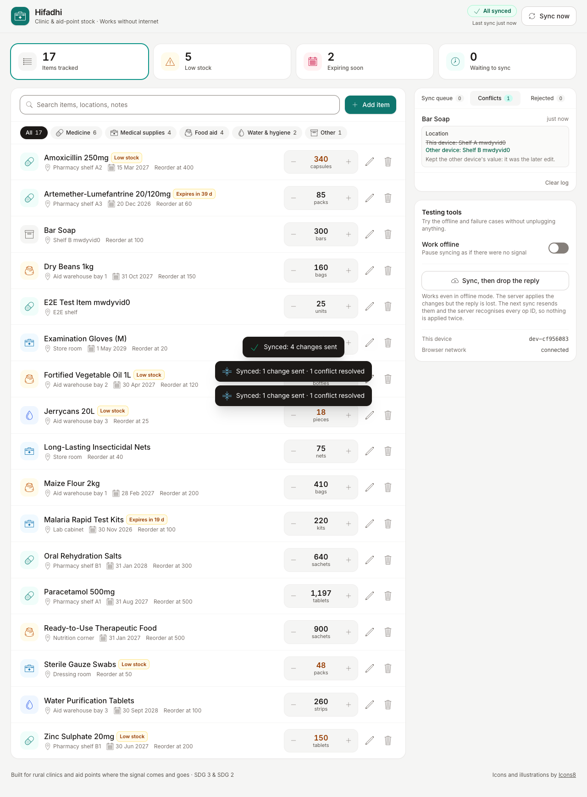
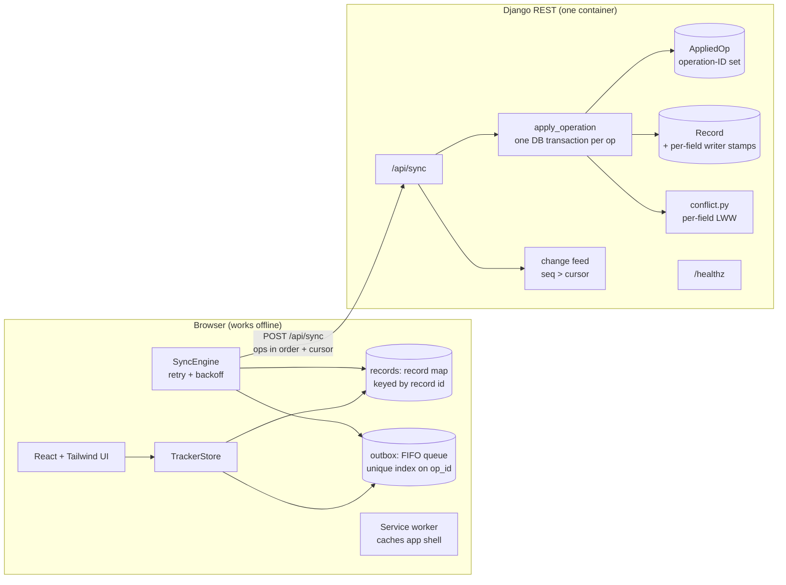

# Hifadhi: offline-first stock tracker for clinics and aid points

*Hifadhi* is Swahili for "keep safe". Rural health centres and food-aid points lose signal for hours or days, so most stock apps stop working right when they're needed. Hifadhi keeps working with no connection at all. Every change is saved on the device straight away, and the app syncs reliably when the network comes back, with no lost or doubled stock movements.

**Zetech Forge 2026 · Software Development · Challenge B: Offline-First Resource Tracker**
**SDG 3 (Good Health and Well-being)** and **SDG 2 (Zero Hunger)**

| | |
|---|---|
| Live app | `https://<your-primecloud-url>/` *(fill in after deploy)* |
| Health check | `https://<your-primecloud-url>/healthz` |
| Source | https://github.com/Tony-Omondi/hifadhi-offline-resource-tracker |
| Tests | 34 backend (pytest) · 21 frontend (Vitest) · 7 end-to-end browser checks · 14 hosted checks (`scripts/hosted_check.py`) |



---

## What it does

- **Full create/read/update/delete with no connection.** Add items, edit them, receive and dispense stock, and delete items. Everything is stored in the browser's IndexedDB.
- **Opens offline too.** A service worker caches the app itself, so reloading the page with no network still works (tested in end-to-end check 2).
- **Durable FIFO sync queue.** Every change becomes an operation with a unique ID. Operations wait in an IndexedDB queue and replay in the exact order they were made, even across reloads and crashes.
- **Exactly-once sync.** The server keeps the set of every operation ID it has applied. A resent operation (after a dropped connection, a retry or a double tap) is recognised and never applied twice.
- **Automatic conflict resolution.** When two devices edit the same field offline, the later edit wins on every device, and the app shows what happened. Edits to different fields both survive. Stock movements from different devices add up instead of overwriting each other.
- **Clinic-ready details:** low-stock and expiry warnings, categories (medicine, medical supplies, food aid, water and hygiene), a search box, quick dispense/receive buttons, a "Work offline" switch and a "drop the reply" button for demonstrating failures.

## Quick start

### Option A: Docker (same image as production)

```bash
docker build -t hifadhi .
```

```bash
docker run -d --name hifadhi -p 8000:8000 -e DJANGO_SECRET_KEY=change-me -e SEED_SAMPLE_DATA=1 -v hifadhi-data:/app/data hifadhi
```

Open http://localhost:8000. Health check: http://localhost:8000/healthz

### Option B: run from source (needs Python 3.12+ and Node 20+)

```bash
python3 -m venv .venv && .venv/bin/pip install -r backend/requirements.txt
```

```bash
cd backend && DJANGO_DEBUG=1 ../.venv/bin/python manage.py migrate && DJANGO_DEBUG=1 ../.venv/bin/python manage.py seed_sample_data && DJANGO_DEBUG=1 ../.venv/bin/python manage.py runserver
```

In a second terminal (Vite dev server on :5173, which forwards `/api` and `/health` to Django):

```bash
cd frontend && npm install && npm run dev
```

To serve the built app from Django instead (needed for the service worker), run `npm run build` in `frontend/` and open http://127.0.0.1:8000.

### Try the offline flow in 1 minute

1. Open the app. The 16 sample items sync down.
2. Turn on **Work offline** (or switch off Wi-Fi). Add an item, dispense a few tablets, edit a location. Watch them line up in **Sync queue**, numbered in order.
3. Reload the page. Everything is still there.
4. Turn **Work offline** off. The queue drains, oldest first, and the badge reads "All synced".
5. For a conflict: open the app in a second browser profile, take both offline, edit the same item's location on each, then reconnect both. The **Conflicts** tab explains which edit won.
6. For a lost reply: make a change, then click **Sync, then drop the reply**. The server applies it but the reply "gets lost". On the next sync the server answers "already on server" and nothing is applied twice.

## Architecture



**One sync round:** the client sends the oldest 50 queued operations plus its cursor (the last change sequence number it has seen). The server applies the operations **in order**, each in its own transaction together with its operation-ID entry, and replies with one result per operation plus every record that changed after the cursor. The client then, in a **single IndexedDB transaction**, removes the acknowledged operations, logs conflicts and rejections, merges the server records, and advances the cursor. Rounds repeat until the queue is empty.

### Sync API

`POST /api/sync`

```json
{
  "device_id": "dev-2acde255",
  "cursor": 41,
  "ops": [
    {
      "op_id": "7c0e…",
      "type": "adjust",
      "record_id": "c41b…",
      "base_version": 3,
      "ts": 1794511125773,
      "device_id": "dev-2acde255",
      "data": { "delta": -5, "reason": "dispensed" }
    }
  ]
}
```

Reply:

```json
{
  "results": [
    { "op_id": "7c0e…", "status": "applied", "conflicts": [], "error": null, "record": { "...": "..." } }
  ],
  "changes": [{ "id": "c41b…", "quantity": 335, "version": 4, "seq": 42, "...": "..." }],
  "cursor": 42,
  "has_more": false,
  "server_time": 1794511126001
}
```

`status` is one of:
- `applied`
- `merged` (applied, with conflicts resolved)
- `duplicate` (already applied before; the original result is returned)
- `rejected` (invalid; kept so retries get the same answer)

Operation types: `create`, `update` (only the changed fields), `adjust` (stock delta), `delete` (tombstone).

| Endpoint | Purpose |
|---|---|
| `GET /healthz` (also `/health`) | 200 `{"status":"ok","database":"ok",...}`, or 503 if the database is down |
| `POST /api/sync` | Push operations and pull changes (see above) |
| `GET /api/records` | The server's current record map (live records) |
| `GET /api/ops` | The 50 most recent entries of the server's operation-ID set |

## Data structures and algorithms

| Structure | Where | What it guarantees | Complexity |
|---|---|---|---|
| **Durable FIFO sync queue** | [frontend/src/lib/queue.js](frontend/src/lib/queue.js): IndexedDB `outbox` store with an auto-increment key | Operations replay in the exact order they were made. They survive reloads and crashes, and are removed only after the server confirms them (peek, then ack). | enqueue O(log n) · peek k O(log n + k) · ack O(log n) each · space O(n) |
| **Record map** | [frontend/src/lib/store.js](frontend/src/lib/store.js): IndexedDB `records` store keyed by record id. Server: `Record` table, primary key = UUID | Instant local reads and writes with no network. Each record write and its queue entry commit in one transaction (both or neither). | get/put O(log n) in IndexedDB (B-tree), O(1) in the in-memory `Map` the UI builds |
| **Operation-ID set** | Server: [`AppliedOp`](backend/sync/models.py) table with `op_id` as primary key. Client: unique index on `outbox.op_id` | The same operation never applies twice. A resend gets the stored result back as `duplicate`. The op's effect and its set entry commit in one transaction, so a crash can't leave "applied but not remembered". | membership O(log n) via the primary-key index (O(1) for a hash set) · insert O(log n) |
| **Conflict resolution** | [backend/sync/conflict.py](backend/sync/conflict.py): per-field last-writer-wins with version-based causality | Every replica converges to the same value whatever order operations arrive in. Concurrent edits to different fields both survive. | O(k) per operation for k changed fields; no history scan |
| **Change feed** | `Record.seq` from a global counter, indexed | A client pulls exactly the records that changed since its cursor, in order, in pages | O(log n + m) for m changes |

### The conflict rule, step by step

Every field on the server remembers its last writer: `{ts, device, version}`. An operation carries `base_version`, the record version the device last saw. For each field it changes:

1. **Not a conflict (causal).** If the field hasn't changed since `base_version`, or this same device wrote it last (its operations arrive in FIFO order), the device was looking at the current value, so its edit is newer by definition. **It is applied even if the device clock is behind.**
2. **Real conflict (concurrent).** Another device changed the field after this device last synced. The write with the larger `(timestamp, device_id)` wins. `device_id` breaks exact ties the same way on every replica. The result is returned as `merged` with `{field, yours, theirs, winner}`, and the app shows it in **Conflicts**.
3. **Stock quantities never conflict.** Receiving and dispensing are sent as deltas (`-5`, `+20`) that add up. If two clinics dispense 30 and 25 from 100 while offline, the result is 45, not 70 or 75.
4. **Deletes are tombstones** (`deleted = true`), so a delete syncs like any other field change.
5. **Clock safety.** Timestamps more than 5 minutes ahead of the server clock are capped, so one device with a wrong clock can't win every future conflict.

Worked example: Bar Soap is at version 1. Device A sets location to "Shelf A" at 10:00:00.000. Device B sets it to "Shelf B" at 10:00:00.050. Both based their edit on version 1, and the edits can reach the server in either order. Either way the server keeps "Shelf B" (the later edit). Whichever device's edit arrives second gets a `merged` result showing what won, and every device ends up with "Shelf B". This is tested on the server ([test_sync_api.py](backend/sync/tests/test_sync_api.py), both arrival orders), on the client ([sync.test.js](frontend/src/lib/sync.test.js)), and in a real browser ([offline-sync.e2e.mjs](frontend/e2e/offline-sync.e2e.mjs)).

## Failure cases

| Failure | What happens | Proved by |
|---|---|---|
| No connection at all | Changes are saved locally and queued. A sync attempt fails, the queue stays intact, and the app retries with backoff (2 s, 4 s, 8 s … up to 60 s) | `sync.test.js` "offline: sync fails, nothing is lost"; e2e checks 2–3 |
| Connection lost **after** the server applied a batch | The client never got the acknowledgement, so it resends. The server finds every op ID in its set and answers `duplicate`. The quantity changes once, not twice. | `test_connection_lost_after_server_applied_then_retry_is_safe`; `sync.test.js`; e2e checks 6–7 (real browser, real server) |
| Server crash in the middle of a batch | Operations before the crash are committed. The crashed one is rolled back together with its op-ID entry. The retry gives `duplicate, duplicate, applied`. | `test_crash_in_the_middle_of_a_batch_keeps_earlier_ops_and_loses_nothing` |
| Same operation sent twice (double tap, overlapping syncs) | The client queue refuses duplicate op IDs, the server dedups, and overlapping `sync()` calls share one run | `queue.test.js`; `test_same_op_twice_in_one_batch_applies_once`; "sync calls made while one is running share it" |
| Conflicting edits on two devices | Per-field last-writer-wins: every device ends with the same value, and the conflict is logged | `test_concurrent_edits_to_the_same_field_converge_whatever_the_arrival_order`; e2e check 5 |
| Concurrent stock movements | The deltas add up | `test_concurrent_stock_movements_add_up_instead_of_overwriting`; "two devices dispensing at once" |
| Invalid operation | That operation is `rejected` and shown under **Rejected**. The rest of the queue keeps flowing (one bad op can't jam it), and a retry gets the same answer. | `test_invalid_op_is_rejected_without_blocking_the_rest_of_the_queue` |
| Device clock far in the future | Capped at server time + 5 min | `test_far_future_device_clock_is_capped` |
| Operations out of order | Shows why FIFO matters: an adjust sent before its create is rejected | `test_out_of_order_ops_fail_which_is_why_the_queue_must_be_fifo` |

## Tests

```bash
cd backend && ../.venv/bin/python -m pytest -v
```

```bash
cd frontend && npm test
```

End-to-end, in a real Chromium browser against a running server (Chrome, Brave or Edge):

```bash
cd frontend && APP_URL=http://localhost:8000 CHROME_PATH="/path/to/chrome" npm run test:e2e
```

| Suite | Count | Covers |
|---|---|---|
| [backend/sync/tests/test_conflict.py](backend/sync/tests/test_conflict.py) | 7 | Conflict rules on their own: causal vs concurrent, timestamp and device tie-break, different fields merge, same-device edits |
| [backend/sync/tests/test_sync_api.py](backend/sync/tests/test_sync_api.py) | 20 | FIFO order, change feed and cursor, op-ID dedup, conflicts in both arrival orders, stock deltas, deletes, all failure cases above, malformed requests, idempotent seeding |
| [backend/sync/tests/test_health.py](backend/sync/tests/test_health.py) | 7 | `/healthz` and `/health` return 200; 503 when the database is down; the probe isn't rejected for an internal Host header or redirected to HTTPS |
| [frontend/src/lib/queue.test.js](frontend/src/lib/queue.test.js) | 6 | FIFO order, peek vs ack, survives reload, duplicate op ID refused, idempotent ack |
| [frontend/src/lib/store.test.js](frontend/src/lib/store.test.js) | 5 | Offline create/update/adjust/delete, only changed fields sent, rebase of pending ops, records never move backwards |
| [frontend/src/lib/sync.test.js](frontend/src/lib/sync.test.js) | 9 | Offline then online, batching in FIFO order, dropped reply, two-device conflict, concurrent dispensing, rejection, no overlapping syncs, transport errors, backoff |
| [frontend/src/App.test.jsx](frontend/src/App.test.jsx) | 1 | App opens with no server at all |
| [frontend/e2e/offline-sync.e2e.mjs](frontend/e2e/offline-sync.e2e.mjs) | 7 checks | Real browser: service worker offline reload, offline queue, reconnect, two-device conflict, dropped reply |
| [scripts/hosted_check.py](scripts/hosted_check.py) | 10 + 4 | Against a live URL: health, sync order, dedup, lost reply, conflict, delete, rejection; then persistence of records and op IDs across a restart or redeploy |

Saved runs and screenshots are in [docs/evidence/](docs/evidence/). A GitHub Actions workflow that runs the backend and frontend suites and boots the Docker image is in [ci/github-actions.yml](ci/github-actions.yml). To switch it on, copy it to `.github/workflows/ci.yml`: GitHub's web editor works, or a login with the `workflow` permission.

## Sample data

[sample_data/clinic_stock.json](sample_data/clinic_stock.json) holds 16 items for a fictional rural health centre and aid point: malaria drugs, rapid test kits, ORS and zinc, gloves and nets, maize flour, beans, therapeutic food, water purification tablets. It includes items that are below their reorder level and items close to expiry.

```bash
cd backend && ../.venv/bin/python manage.py seed_sample_data
```

The seed goes through the normal sync path with fixed op IDs, so running it twice prints `16 applied`, then `16 duplicate`. That's the operation-ID set at work.

## Deploying to PrimeCloud

The repository builds into one Docker image. A Node stage builds the React app, and the runtime is Python 3.12 + gunicorn. The same container serves the web app, the sync API and the health check, so there is one HTTPS URL to submit.

| Setting | Value |
|---|---|
| Repository / branch | `Tony-Omondi/hifadhi-offline-resource-tracker` · `main` · application directory `/` (root) |
| Build | Detected from the root `Dockerfile` (no separate build command) |
| Start command | `./start.sh` (the image's default: runs migrations, optionally loads sample data, then `exec gunicorn`) |
| Listen address / port | `0.0.0.0:$PORT` (read from the `PORT` variable; 8000 if unset). Set the Target Port to the same value. |
| Health check path | `/healthz` (also `/health`). Returns 200 in milliseconds, or 503 if the database is unreachable. No secrets in the reply. |
| Shutdown | gunicorn is PID 1, receives SIGTERM and stops within 8 s (PrimeCloud allows 10 s). An op is acknowledged only after its transaction commits. |
| Memory | About 105 MiB with 2 workers, measured. Fits the 512 MiB trial. |

### Steps (Console route)

1. In the PrimeCloud Console, open the project and environment the organisers assigned. Create an application from **GitHub**, authorise only this repository, pick branch `main` and root directory `/`. Record the commit that gets deployed.
2. Set the Target Port to match `$PORT`, and the health check path to `/healthz`.
3. **Give it storage that survives redeploys** (required for Challenge B; confirm with the Technical Lead which one your team is allocated):
   - **Managed PostgreSQL (preferred):** bind it with Vault so the URL is never in plain text. For example, `primecloud app bind --app <your-app> --db <your-db> --env DATABASE_URL`. The app reads `DATABASE_URL`, and `psycopg` is already installed.
   - **Persistent disk:** mount it at `/app/data`. With no `DATABASE_URL`, the app keeps SQLite at `/app/data/db.sqlite3`, and `start.sh` refuses to start if that folder isn't writable.
4. Set the environment variables below, then deploy and watch the build and runtime logs until the app reports healthy.
5. Run the hosted checks (next section). Restart or redeploy, then run the after-restart check.

| Variable | Secret? | Value |
|---|---|---|
| `DJANGO_SECRET_KEY` | **yes**, via Vault | a long random string, e.g. `python3 -c "import secrets; print(secrets.token_urlsafe(50))"` |
| `DATABASE_URL` | **yes**, via Vault binding | managed PostgreSQL URL. Leave unset when using a persistent disk instead. |
| `DJANGO_ALLOWED_HOSTS` | no | the hostname PrimeCloud assigns, e.g. `hifadhi-xxxx.<primecloud-domain>` |
| `DJANGO_CSRF_TRUSTED_ORIGINS` | no | the same host with `https://` |
| `DJANGO_SECURE_SSL_REDIRECT` | no | `1` (health checks are exempt) |
| `SEED_SAMPLE_DATA` | no | `1` loads the 16 sample items. It's safe to leave on, because reloading is deduplicated by op ID. |
| `WEB_CONCURRENCY` | no | `2` gunicorn workers (default) |
| `FAULT_INJECTION_ENABLED` | no | `1` (default) keeps the "drop the reply" demo button working during judging |

The health check is answered before Django's host check, so the platform's probe works even when it calls the container by an internal address. Every other route still enforces `DJANGO_ALLOWED_HOSTS`.

### Verifying the hosted app

```bash
python3 scripts/hosted_check.py https://<your-app-url> --save hosted-state.json --report docs/evidence/hosted-check.md
```

This checks `/healthz` and the app shell, ordered sync, op-ID dedup, a lost reply followed by a retry, two-device conflict resolution, deletes and invalid ops, all against the live server. Then restart or redeploy in the console and run:

```bash
python3 scripts/hosted_check.py https://<your-app-url> --after-restart hosted-state.json --report docs/evidence/hosted-check-after-restart.md
```

This proves that the records **and the operation-ID set** survived: every old operation comes back as `duplicate`. Then do the two-browser walkthrough from "Try the offline flow" on the live URL.

The same checks pass locally against the production image, with SQLite on a mounted volume and with PostgreSQL 16: 10/10 before and 4/4 after recreating the container. See [docs/evidence/hosted-check-postgres.md](docs/evidence/hosted-check-postgres.md) and [hosted-check-postgres-after-redeploy.md](docs/evidence/hosted-check-postgres-after-redeploy.md).

**Before judging:** trial apps sleep after 15 minutes idle. Open the URL and `/healthz` a few minutes before your slot.

### Any other Docker host

```bash
docker build -t hifadhi . && docker run -p 8000:8000 -e DJANGO_SECRET_KEY=change-me -e SEED_SAMPLE_DATA=1 -v hifadhi-data:/app/data hifadhi
```

## Project layout

```
backend/
  config/            Django settings (all from env vars), URLs
  sync/
    models.py        Record, AppliedOp (op-ID set), SyncCounter
    conflict.py      per-field LWW rules (pure functions)
    validation.py    checks every incoming operation
    services.py      apply_operation (exactly once), change feed
    views.py         /healthz, /api/sync, /api/records, /api/ops
    middleware.py    answers health probes before host checks and redirects
    tests/           pytest suites
frontend/
  src/lib/           idb.js · queue.js (FIFO) · store.js (record map) · merge.js · sync.js (engine)
  src/components/    UI (React + Tailwind, Icons8 icons and illustrations)
  src/hooks/         useTracker: state, auto-sync, backoff
  public/sw.js       service worker (offline app shell)
  e2e/               real-browser end-to-end test
sample_data/         clinic and aid-point stock list
docs/                evidence, demo script, submission notes
scripts/hosted_check.py  functional + restart-persistence check against a live URL
backend/start.sh     container start: migrate, optional seed, exec gunicorn
Dockerfile           Node build stage + Python runtime
```

## Known limitations

- **No login or multi-site separation.** Every device sees the same stock list. A real rollout needs accounts and one list per facility.
- **Last-writer-wins uses device clocks** for truly concurrent edits. Causal edits ignore clocks, and clocks far in the future are capped, but two devices with clocks a few minutes apart could still pick the "wrong" winner for a simultaneous edit. A hybrid logical clock would fix this.
- **Text fields don't merge character by character.** Two concurrent edits to the same notes field keep one whole value (the other is shown in the conflict log).
- **Deletes win** over concurrent edits to other fields of the same item. An item can't be restored from the UI.
- **The very first visit needs a connection** to download the app. After that it opens offline.
- **SQLite on a persistent disk** is fine for one clinic or a demo. For many sites at once, use managed PostgreSQL through `DATABASE_URL`.
- **Trial hosting sleeps after 15 minutes idle**, so the first request after a nap is slow. The app itself keeps working offline in the meantime, and changes sync once the server wakes.
- **The demo failure button** (`X-Simulate-Failure` header) is on by default for judging. Set `FAULT_INJECTION_ENABLED=0` in a real deployment.

## Tech stack

React 19 · Vite 8 · Tailwind CSS 4 · IndexedDB · Service Worker · Django 5.2 · Django REST Framework 3.18 · PostgreSQL (psycopg 3) or SQLite on a persistent disk · gunicorn · WhiteNoise · Docker · pytest · Vitest · fake-indexeddb · Playwright (core)

## Third-party licences

| Dependency | Licence |
|---|---|
| Django, Django REST Framework | BSD-3-Clause |
| React, Vite, Tailwind CSS, Vitest, fake-indexeddb, WhiteNoise, dj-database-url | MIT |
| gunicorn | MIT |
| psycopg 3 | LGPL-3.0 (used unmodified as a library) |
| Playwright | Apache-2.0 |
| Inter typeface (`@fontsource-variable/inter`) | SIL Open Font License 1.1 |
| Icons (iOS outline set) | [Icons8](https://icons8.com) licence. Free use requires the link attribution, shown in the app footer. |
| Empty-state illustrations (Ouch! "Fogg" style) | [Icons8](https://icons8.com/illustrations), marked free to redistribute. Credited in the app footer. |

No sponsor APIs or external datasets are used. The sample data is fictional.

## Team and AI disclosure

See [docs/SUBMISSION.md](docs/SUBMISSION.md) for team members, the Alumni/Finalist Collaborator's contribution, the SDG impact statement and the AI-tool disclosure.
